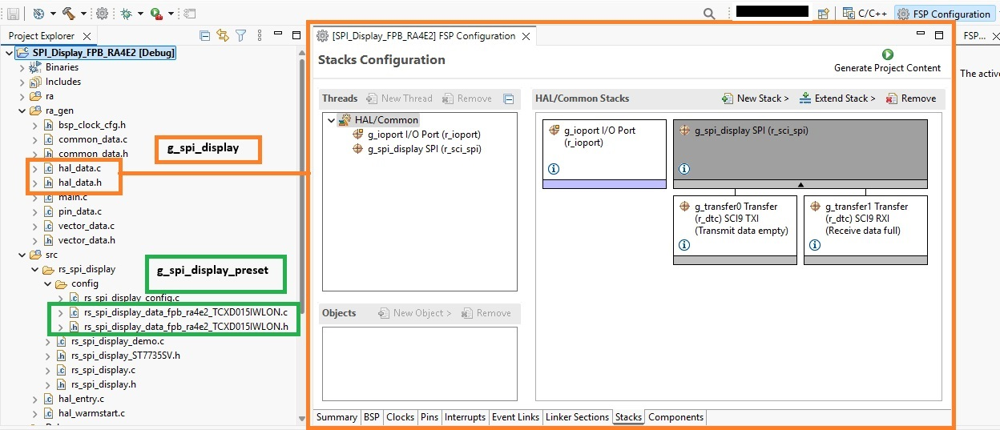
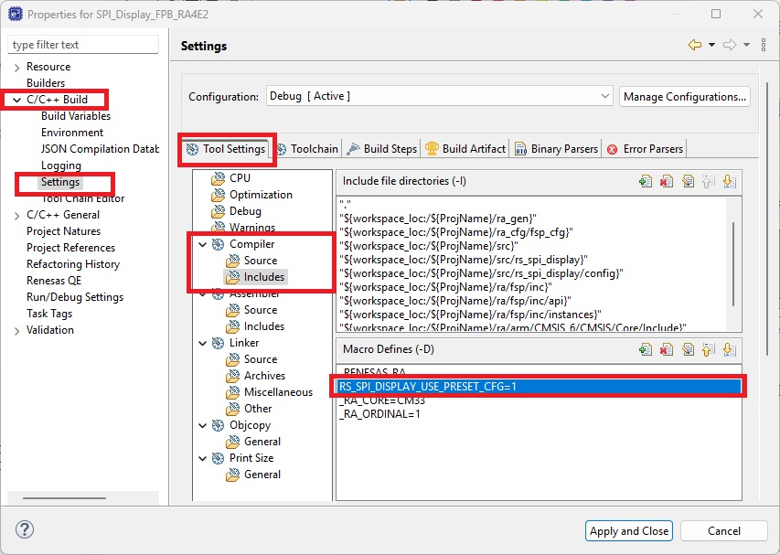
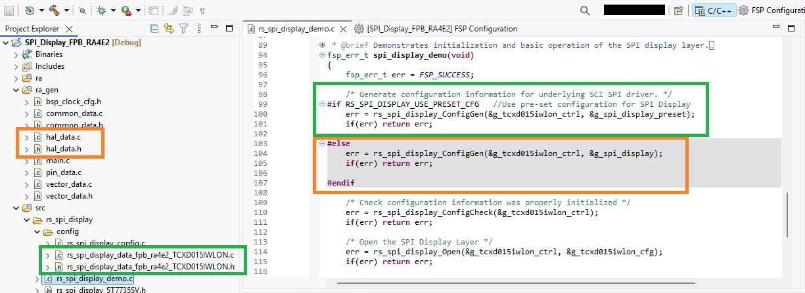
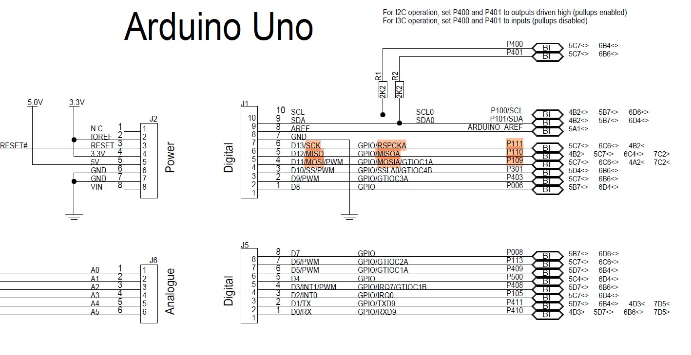
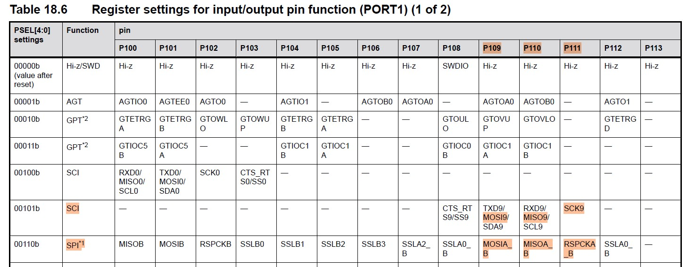
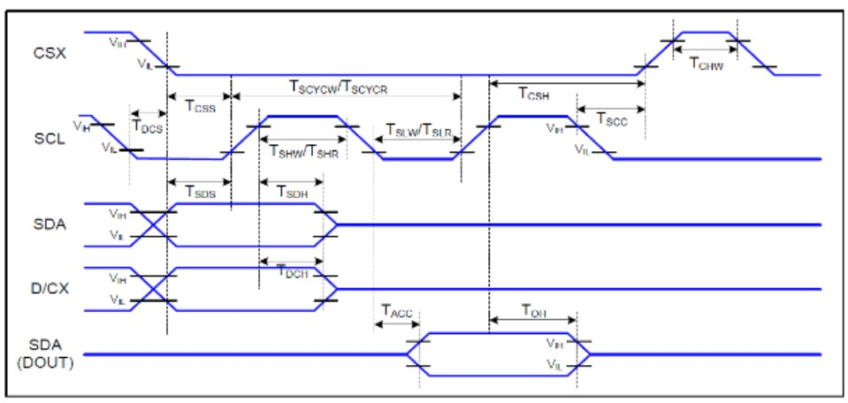
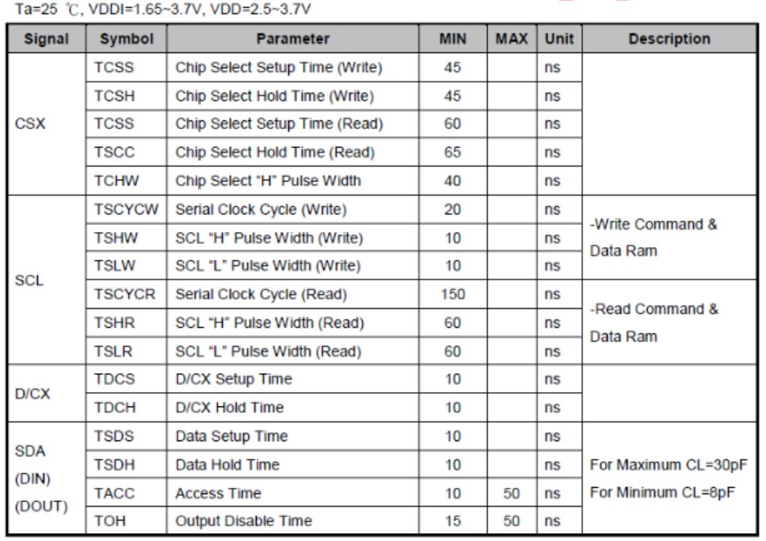
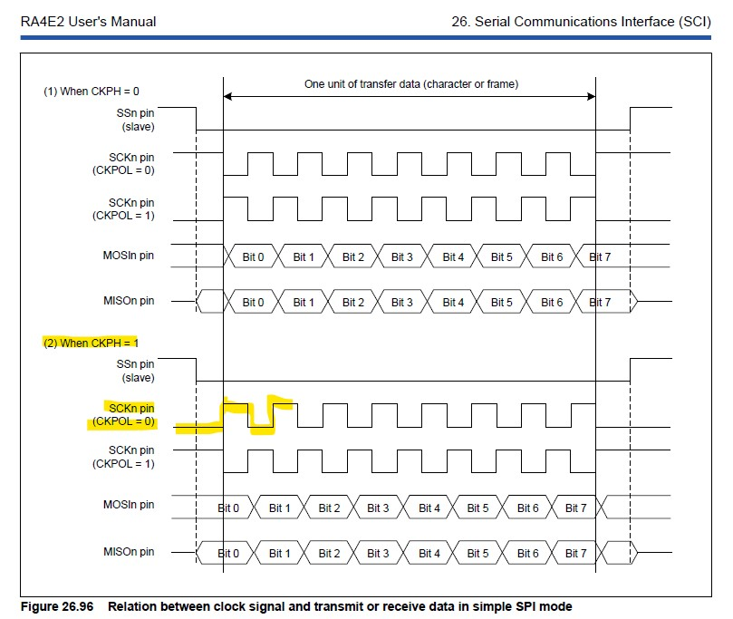

# SPI Display

Graphical displays are commonly used in embedded systems to provide intuitive visual interfaces for status, controls, measurements, and other application information.

This project demonstrates how a Renesas RA MCU can interface with an external SPI display using a reusable software layer. The layer supports LCD and OLED displays using RGB565 color encoding, with resolutions up to 480 × 480 pixels.

The included example targets a 128 × 128 pixel TFT LCD using 16-bit RGB565 color encoding and demonstrates basic graphics operations as a starting point for integrating SPI displays into custom designs.

A complete e² studio example project is included to demonstrate basic graphics operations and provide a starting point for integrating SPI displays into custom designs.

## Key Features
* External graphical display interface via SPI using the RA FSP SCI SPI peripheral
* Example e² studio project demonstrates display initialization and basic graphics operations
* Demo application is implemented with a reusable public function layer
* Supports RGB565 color format for graphical display data
* Supports common display operations including screen fill and image/framebuffer data transfer
* Designed for integration into embedded HMI, industrial, consumer, and IoT applications

# Repository Organization

The repository is organized into major areas:

| Area | Purpose|
|-|-|
| docs/ | Documentation for the rs_servo public instance and demonstration. |
| examples/ | Complete reference project(s) for hardware evaluation and demonstration. |
| src/ | Reusable configuration, public functions, and demonstration files. |

# Table of Contents

1. [Running the Demo Application](#1-running-the-demo-application)
    - 1.1 [Required Resources](#11-required-resources)
        - 1.1.1 [Hardware](#111-hardware)
        - 1.1.2 [Software](#112-software)
        - 1.1.3 [Connect Display to MCU](#113-connect-display-to-mcu)
    - 1.2 [Using FSP Stack vs Preset Configurations](#12-using-fsp-stack-vs-preset-configurations)

2. [Choosing the Right FSP SPI Peripheral](#2-choosing-the-right-fsp-spi-peripheral)
    - 2.1 [Pinout](#21-pinout)
    - 2.2 [Clock Frequency and Throughput](#22-clock-frequency-and-throughput)
    - 2.3 [SPI Peripheral Selection](#23-spi-peripheral-selection)

3. [Application Overview](#3-application-overview)
    - 3.1 [Hardware](#31-hardware)
        - 3.1.1 [TCXD015IWLON SPI Interface Requirements](#311-tcxd015iwlon-spi-interface-requirements)
    - 3.2 [R_SCI_SPI on RA4E2](#32-r_sci_spi-on-ra4e2)
        - 3.2.1 [R_SCI_SPI Module Stack Config](#321-r_sci_spi-module-stack-config)
        - 3.2.2 [R_SCI_SPI Pin Config](#322-r_sci_spi-pin-config)
        - 3.2.3 [R_SCI_SPI Clock Config](#323-r_sci_spi-clock-config)

4. [Public Function Layer: rs_spi_display](#4-public-function-layer-rs_spi_display)
    - 4.1 [Source Files](#41-source-files)
    - 4.2 [Public Data](#42-public-data)
        - 4.2.1 [Macros](#421-macros)
        - 4.2.2 [Display Device Configuration](#422-display-device-configuration)
        - 4.2.3 [SPI Display Control Block](#423-spi-display-control-block)
    - 4.3 [Display Controller Library](#43-display-controller-library)
    - 4.4 [Public Functions](#44-public-functions)
        - 4.4.1 [rs_spi_display_Open()](#441-rs_spi_display_open)
        - 4.4.2 [rs_spi_display_Close()](#442-rs_spi_display_close)
        - 4.4.3 [rs_spi_display_SendInitSequence()](#443-rs_spi_display_sendinitsequence)
        - 4.4.4 [rs_spi_display_SendCommand()](#444-rs_spi_display_sendcommand)
        - 4.4.5 [rs_spi_display_SendData()](#445-rs_spi_display_senddata)
        - 4.4.6 [rs_spi_display_FillScreen()](#446-rs_spi_display_fillscreen)
        - 4.4.7 [rs_spi_display_DrawColoredBars()](#447-rs_spi_display_drawcoloredbars)
        - 4.4.8 [rs_spi_display_DrawFramebuffer()](#448-rs_spi_display_drawframebuffer)
        - 4.4.9 [Configuration Functions](#449-configuration-functions)
        - 4.4.10 [Internal Functions](#4410-internal-functions)
    - 4.5 [Demo Application Layer](#45-demo-application-layer)

5. [Limitations](#5-limitations)

6. [Integration / Reusability](#6-integration--reusability)
    - 6.1 [Using the TCXD015IWLON Display](#61-using-the-tcxd015iwlon-display)
    - 6.2 [Using Another ST77-Series Display](#62-using-another-st77-series-display)
    - 6.3 [Using a Different Display Controller](#63-using-a-different-display-controller)

# 1. Running the Demo Application

The example application titled "SPI_Display_FPB_RA4E2 has an e² studio version located in /examples/e2studio and VS Code cmake version in /examples/vscode.

## 1.1 Required Resources
To build and run the project, the following resources are needed:

### 1.1.1 Hardware
* Renesas RA MCU FPB-RA4E2
* USB Debug Cable
* TCXD015IWLON-1 Display & Arduino shield

### 1.1.2 Software
* IDE
    * e² studio v2026-04.2 OR
    * VS Code with Renesas Platform Extension
* FSP v6.5.0
* LLVM for ARM v21.1.1

### 1.1.3 Connect Display to MCU
Connect the TCXD015IWLON-1 display by aligning the Arduino shield with the Arduino pinout on the FPB-RA4E2.

The display should be viewed from the perspective where the debug cable to the FPB is above the display.

## 1.2 Using FSP Stack vs Preset Configurations
In the project, the required SCI SPI module settings are saved in flash and at runtime are copied into SRAM for use by the FSP APIs. The settings configured the SPI bus interface on the FPB-RA4E2 to match the TCXD015IWLON-1.

There are 2 identical flash copies of the required configurations in the project:
* g_spi_display 
    * Located in /ra_gen folder in hal_data.c and .h
    * Data is auto generated based on the project's FSP Stack and Pin configurations
* g_spi_display_preset
    * Located in /src/rs_spi_display/config directory in rs_spi_display_data_fpb_ra4e2_TCXD015IWLON.c and .h
    * Data is identical copy of the FSP configurations

The following image shows the files containing the flash configuration copies in the project's workspace. The FSP configuration files with flash instance **g_spi_display** are highlighted in orange and those with flash instance **g_spi_display_preset** are highlighted in green.

<br>

The macro RS_SPI_DISPLAY_USE_PRESET_CFG is defined in the Project Properties > C/C++ Build settings. It determines which flash configuration will be copied into SRAM at runtime. Its value can be set using the project property shown below:

 C/C++ Build > Settings > Tool Settings tab > Compiler > Includes > Macro Defines section" width="500"/><br>

The application routine spi_display_demo() initializes the SPI bus, by calling the rs_spi_display_ConfigGen() with the SCI SPI instance that corresponds to the value of RS_SPI_DISPLAY_USE_PRESET_CFG.
* RS_SPI_DISPLAY_USE_PRESET_CFG = 1 selects **g_spi_display_preset**
* RS_SPI_DISPLAY_USE_PRESET_CFG = 0 selects **g_spi_display**

<br>

# 2 Choosing the Right FSP SPI Peripheral
On the FPB-RA4E2 both the SCI (Serial Communications Interface) in SPI mode and the dedicated SPI peripheral are capable of providing SPI communication for an external display.

## 2.1 Pinout
To select the appropriate SPI peripheral, first determine which modules can be routed to the required interface pins. For this project, the display is connected through the Arduino header. 

Both SPI Channel 0 and SCI SPI Channel 9 can be routed to the required Arduino header pins P111, P110, and P109.

<br>

<br>

## 2.2 Clock Frequency and Throughput
Next, compare the supported SPI clock frequencies. The SPI clock frequency determines the bit rate available for transferring display data, which in turn determines the maximum achievable display throughput and frame rate.

The theoretical maximum frame rate can be estimated from the SPI bit rate, display resolution, and color depth:

```text
Bits per frame = Horizontal Resolution x Vertical Resolution x Bits per Pixel

Maximum Frame Rate (FPS) = SPI Bit Rate / Bits per Frame
```

For a 128 x 128 display using RGB565 (16 bits per pixel):

```text
Bits per frame = 128 x 128 x 16
               = 262,144 bits
```

For the dedicated SPI peripheral at 16 MHz:

```text
Maximum FPS = 16,000,000 / 262,144
            = 61 FPS
```

For the SCI SPI peripheral at 25 MHz:

```text
Maximum FPS = 25,000,000 / 262,144
            = 95 FPS
```

These values represent the theoretical maximum frame rate based on pixel data transfer. The actual frame rate may be lower due to command transfers, software processing, and other transfer overhead.

## 2.3 SPI Peripheral Selection
For this project, SCI SPI Channel 9 was selected because it supports the required Arduino header pin routing and provides a higher maximum SPI bit rate of 25 MHz, compared with 16 MHz for the dedicated SPI peripheral. This provides greater potential display throughput and frame rate

# 3. Application Overview
This project demonstrates the SPI display software layer using a 128 x 128 pixel TFT LCD with RGB565 color encoding connected to an FPB-RA4E2 board.

The application configures the SCI SPI peripheral for the external display, sends the display initialization sequence, demonstrates a full-screen fill using blue, and then draws horizontal RGB565 color bars representing the primary and secondary RGB color combinations, along with white and black.

The project provides a reusable public function layer for initializing and performing basic graphics operations on SPI displays. The `spi_display_demo()` entry point demonstrates the complete application flow from SPI configuration through drawing to the display.

Together, these features demonstrate how the FPB-RA4E2 and SCI SPI peripheral can be configured and used to interface with an external SPI display.

## 3.1 Hardware
The demo application runs on the follwoing hardware:

RA MCU:
* FPB-RA4E2 
    * [RA4E2 Group User's Manual: Hardware ](https://www.renesas.com/en/document/mah/ra4e2-group-users-manual-hardware)

External Display:
* TCXD015IWLON-1, 1.5' TFT 128x128  
    * Visit manufacturer for datasheet

### 3.1.1 TCXD015IWLON SPI Interface Requirements
The TCXD015IWLON-1 defines timing requirements for the SPI clock, chip select, and data signals. For write operations, the minimum serial clock cycle is 20 ns, the minimum SCL high and low periods are 10 ns, and the chip select setup and hold times are 45 ns.


<br>

<br>

The standard SCI SPI signal timing satisfies these requirements, so no additional signal hold cycles are required for this project.

The display supports both 3-wire and 4-wire SPI communication. This project uses the **4-wire SPI interface**, which provides a dedicated Data/Command (D/C) signal and allows commands and data to be transferred as standard 8-bit SPI packets, matching the transfer format used by SCI SPI on the RA4E2.

The display also requires the serial clock to idle low, with data sampled on the rising edge and changed on the falling edge. These requirements determine the clock polarity and clock phase settings used for SCI SPI.

## 3.2 R_SCI_SPI on RA4E2
The SCI SPI peripheral on the RA4E2 provides the SPI communication interface between the FPB-RA4E2 and the external display.

The following sections describe the FSP module stack, pin, and clock configurations used by this project.

### 3.2.1 R_SCI_SPI Module Stack Config
The R_SCI_SPI module is configured to match the SPI interface requirements of the TCXD015IWLON-1 and the FPB-RA4E2 hardware connections described in the previous sections.

The following FSP properties are used for this project:

| Property Name | Value Used | Reason |
|-|-|-|
| DTC Support | Enabled | Enables DTC support for SPI transfers, allowing transfer data to be handled without continuous CPU intervention. |
| General → Name | `g_spi_display` | Descriptive name for the SCI SPI instance used to interface with the external display. |
| General → Channel | 9 | SCI SPI Channel 9, pin group B, maps to the SPI pins used on the FPB-RA4E2 Arduino header. |
| General → Operating Mode | Master | Configures the RA4E2 as the SPI master controlling communication with the external display. |
| General → Clock Phase | Data sampling on odd edge, data variation on even edge | Matches the clock and data timing requirements of the TCXD015IWLON-1. |
| General → Clock Polarity | Low when idle | Matches the idle-low serial clock required by the TCXD015IWLON-1. |
| General → Bit Order | MSB First | Matches the bit order used by the ST7735SV display controller. |
| General → Callback | `spi_display_callback` | Handles SPI transfer-complete events used by the SPI display software layer. |
| General → Bitrate | 25000000 | Configures a 25 MHz SPI bit rate for increased display data throughput. |

**Clock Polarity and Phase Selection**

The SCI SPI clock polarity and phase settings must be selected together to match the display's required clock behavior. 

The TCXD015IWLON-1 requires the serial clock to remain low while idle, with data sampled on the rising edge (odd) and changed on the falling edge (even).

For R_SCI_SPI, this behavior is satisfied when **CKPOL = 0** and **CKPH = 1**, as shown in the timing diagram below. In FSP, these register settings correspond to:

- **Clock Polarity:** Low when idle
- **Clock Phase:** Data sampling on odd edge, data variation on even edge

<br>

These settings ensure that each data bit is stable when sampled by the display.

### 3.2.2 R_SCI_SPI Pin Config

The following pin assignments connect the FPB-RA4E2 to the external display:

| Display Signal | RA4E2 Pin | Configuration |
|-|-|-|
| SCK | P111 | SCK9 |
| MISO | P110 | RXD9 |
| MOSI | P109 | TXD9 |
| CS | P301 | GPIO |
| D/C | P302 | GPIO |
| RESET | P303 | GPIO |

<br>

SCI SPI Channel 9, pin group B, routes SCK, MISO, and MOSI to the FPB-RA4E2 Arduino header.

The remaining display control signals are configured as GPIO. The SCI SPI Channel 9 SS signal does not route to the required Arduino header connection, so **P301 is used as a software-controlled Chip Select**. The **Data/Command and Reset signals** are similarly controlled through GPIO using **P302 and P303**, respectively.

This allows the SPI display software layer to control CS, D/C, and RESET independently of the SCI SPI peripheral.

### 3.2.3 R_SCI_SPI Clock Config

The default FPB-RA4E2 clock configuration is sufficient for this project and does not require modification.

In master mode, the SCI SPI peripheral uses **PCLKA** as the source clock and divides it to generate the SCK output.

Since the default clock configuration supports the **25 MHz SCI SPI bit rate** selected for this project,  no changes are required in the FSP Clock configuration tree.

# 4 Public Function Layer: rs_spi_display
The spi display public functino layered **rs_spi_display** is detailed here.

## 4.1 Source Files

The source files can be found in the repo's `/src` folder and are located in the e² studio project's `/src/rs_spi_display` folder.

| File | Contents |
|-|-|
| `rs_spi_display.c` | Contains the public-function definitions for the **rs_spi_display** layer, along with internal helper functions. |
| `rs_spi_display.h` | Contains the public data and function declarations for the **rs_spi_display** layer. Any application files calling the public functions need to include this file. |
| `rs_spi_display_ST7735SV.h` | Contains the ST7735SV display controller-specific command definitions used by the **rs_spi_display** layer. |
| `rs_spi_display_demo.c` | Application layer which uses the public functions to demonstrate operation of the SPI display, including filling the display with a single color and drawing graphical content from a framebuffer. |
| `config/rs_spi_display_config.c` | Contains the configuration generation used to initialize the **rs_spi_display** control structure for the selected hardware configuration. |
| `config/rs_spi_display_data_fpb_ra4e2_TCXD015IWLON.c` | Pre-configured data for the FPB-RA4E2 and TCXD015IWLON display hardware combination. |
| `config/rs_spi_display_data_fpb_ra4e2_TCXD015IWLON.h` | Contains the declarations and supporting data required for the FPB-RA4E2 and TCXD015IWLON display configuration. |

> ℹ To use the **rs_spi_display** layer, copy `rs_spi_display.c`, `rs_spi_display.h`, and the required display controller header into the target project's source folder. The appropriate files from the `config` folder should also be included for the target hardware configuration. Include `rs_spi_display.h` in each application file that uses the layer.

## 4.2 Public Data
The following macros are defined in the rs_spi_display.h file and support the public functions.

### 4.2.1 Macros

The following macros are defined in the `rs_spi_display.c` file and support the public functions.

**SPI Transfer**

| Name | Value | Use |
|-|-|-|
| RS_SPI_DISPLAY_TRANSFER_TIMEOUT | 1000000U | Timeout count used while waiting for an SPI transfer to complete. |

**Display Initialization**

| Name | Value | Use |
|-|-|-|
| RS_SPI_DISPLAY_USE_DELAY | 0x80 | Identifies initialization commands that require a delay after execution. |
| RS_SPI_DISPLAY_DELAY_120_MS | 120 | Provides a 120 ms delay during display initialization. |
| RS_SPI_DISPLAY_DELAY_50_MS | 50 | Provides a 50 ms delay during display initialization. |
| RS_SPI_DISPLAY_DELAY_10_MS | 10 | Provides a 10 ms delay during display initialization. |

**Display Resolution**

| Name | Value | Use |
|-|-|-|
| RS_SPI_DISPLAY_MIN_X_RES | 8 | Minimum supported horizontal display resolution. |
| RS_SPI_DISPLAY_MIN_Y_RES | 8 | Minimum supported vertical display resolution. |
| RS_SPI_DISPLAY_MAX_X_RES | 480 | Maximum supported horizontal display resolution. |
| RS_SPI_DISPLAY_MAX_Y_RES | 480 | Maximum supported vertical display resolution. |

**RGB565 Colors**

| Name | Value | Use |
|-|-|-|
| RS_SPI_DISPLAY_RGB565_RED | 0xF800 | RGB565 value for red. |
| RS_SPI_DISPLAY_RGB565_GREEN | 0x07E0 | RGB565 value for green. |
| RS_SPI_DISPLAY_RGB565_BLUE | 0x001F | RGB565 value for blue. |
| RS_SPI_DISPLAY_RGB565_YELLOW | 0xFFE0 | RGB565 value for yellow. |
| RS_SPI_DISPLAY_RGB565_PURPLE | 0xF81F | RGB565 value for purple. |
| RS_SPI_DISPLAY_RGB565_CYAN | 0x07FF | RGB565 value for cyan. |
| RS_SPI_DISPLAY_RGB565_WHITE | 0xFFFF | RGB565 value for white. |
| RS_SPI_DISPLAY_RGB565_BLACK | 0x0000 | RGB565 value for black. |
| RS_SPI_DISPLAY_NUM_DEF_COLORS | 8 | Number of predefined RGB565 colors provided by the layer. |
| RS_SPI_DISPLAY_RGB565_BYTES_PER_PIXEL | 2 | Number of bytes used to represent one RGB565 pixel. |

### 4.2.2 Display Device Configuration

The type *rs_spi_display_device_cfg_t* describes the hardware-specific configuration of an external SPI LCD or OLED display. This allows the **rs_spi_display** layer to support different display devices and controllers through a common configuration structure.

> ℹ The application must define a const *rs_spi_display_device_cfg_t* and initialize the members for the selected display hardware and controller.

> ℹ The initialization sequence must contain the commands, arguments, and delays required by the selected display controller. A complete initialization sequence for the TCXD015IWLON display used by this example project is provided.

| Member Name | Type | Use |
|-|-|-|
| reset_pinout | bsp_io_port_pin_t | GPIO pin connected to the display reset signal. |
| reset_active_lvl | bsp_io_level_t | GPIO level used to assert the display reset signal. |
| reset_inactive_lvl | bsp_io_level_t | GPIO level used to release the display reset signal. |
| reset_delay_ms | uint16_t | Required reset delay in milliseconds. |
| chip_select_pinout | bsp_io_port_pin_t | GPIO pin connected to the display chip-select signal. |
| cs_active_lvl | bsp_io_level_t | GPIO level used to select the display. |
| cs_inactive_lvl | bsp_io_level_t | GPIO level used to deselect the display. |
| data_command_pinout | bsp_io_port_pin_t | GPIO pin connected to the display data/command signal. |
| data_lvl | bsp_io_level_t | GPIO level used when transmitting display data. |
| command_lvl | bsp_io_level_t | GPIO level used when transmitting display commands. |
| write_gddram_command | uint8_t | Display controller command used to begin writing pixel data to GDDRAM. |
| canvas_x_resolution | uint16_t | Horizontal resolution of the display canvas in pixels. |
| canvas_y_resolution | uint16_t | Vertical resolution of the display canvas in pixels. |
| p_display_init_sequence | const uint8_t * | Pointer to the display controller initialization command sequence. |

**Display Initialization Sequence**

The *p_display_init_sequence* member points to the command sequence used to initialize the display controller. The **rs_spi_display** initialization function expects the sequence in the following format:

```text
N,                              Number of commands in the sequence

CMD1,                           Command
    n | Delay?,                 Number of arguments and optional delay flag
    arg1, arg2, ..., argn,      Command arguments
    delay_ms,                   Delay duration, if required

CMD2,
    n | Delay?,
    arg1, ..., argn,
    delay_ms,

...

CMDN, ...
```

The first byte specifies the total number of commands in the sequence. Each command is followed by the number of associated arguments and the argument data.

`RS_SPI_DISPLAY_USE_DELAY` can be combined with the argument count to indicate that a delay is required after sending the command. When set, the byte following the command arguments specifies the delay duration in milliseconds.

```text
n | RS_SPI_DISPLAY_USE_DELAY
```

This format allows the initialization sequence required by the selected display controller to be provided through the device configuration without changing the **rs_spi_display** initialization function.

### 4.2.3 SPI Display Control Block

The type *rs_spi_display_ctrl_t* provides a control block for the **rs_spi_display** functions. It contains the SPI bus instance, external display device configuration, and runtime data used by the layer.

To guarantee proper operation of the **rs_spi_display** layer, application code should not directly modify members of an *rs_spi_display_ctrl_t* instance.

| Member Name | Type | Use |
|-|-|-|
| open | bool | Current state of the SPI display instance. |
| spi_bus_ctrl | sci_spi_instance_ctrl_t | SRAM control structure used by the SCI SPI HAL. |
| spi_bus_cfg | spi_cfg_t | SRAM copy of the SPI configuration used by the SCI SPI HAL. |
| spi_bus_cfg_extend | sci_spi_extended_cfg_t | SRAM copy of the extended configuration used by the SCI SPI HAL. |
| spi_bus | spi_instance_t | SPI instance containing the control, configuration, and interface pointers used to access the SCI SPI HAL. |
| p_device | const rs_spi_display_device_cfg_t * | Pointer to the display device configuration described in Section 4.2.2. |
| canvas_pixel_count | uint32_t | Total number of pixels in the configured display canvas. This value is calculated when the display is opened from the configured X and Y resolutions. |

The TCXD015IWLON demo application creates a control instance for the display:

```c
rs_spi_display_ctrl_t g_tcxd015iwlon_ctrl;
```

> ℹ The application must define an *rs_spi_display_ctrl_t* instance for each display. The control instance is passed to the **rs_spi_display** public functions and should not be modified directly by the application.

## 4.3 Display Controller Library

The TCXD015IWLON display used in this example project is controlled by the ST7735SV display controller. The `rs_spi_display_ST7735SV.h` file provides the controller-specific command definitions, configuration values, and initialization data required by the **rs_spi_display** layer.

The library includes:

- **Command definitions** – Defines the ST7735SV command set used for display control, configuration, memory access, and status operations.
- **D/CX signal levels** – Defines the active data and command logic levels for the D/CX signal.
- **CS signal levels** – Defines the active and inactive logic levels for the CS signal.
- **RESET signal levels and timing** – Defines the active and inactive logic levels for the RESET signal and the required reset delay.

These definitions are used by the display device configuration and **rs_spi_display** functions, keeping controller-specific requirements separate from the reusable display layer.

For complete command descriptions, register definitions, and controller specifications, refer to the [ST7735SV Datasheet](https://datasheet4u.com/pdf/1518418/ST7735SV.pdf). 

## 4.4 Public Functions

The public functions provide configuration, initialization, communication, and graphics operations for the **rs_spi_display** layer.

> ℹ To use the functions in an application, include the **rs_spi_display** source and header files in the target project and include `rs_spi_display.h` in each application file that uses the layer.

**Configuration Functions**

| Function | Module State | Description |
|-|-|-|
| `rs_spi_display_ConfigGen(rs_spi_display_ctrl_t *, const spi_instance_t *)` | Closed | Copies the selected FSP SPI instance configuration into the display control block and builds the SPI instance used by the layer. |
| `rs_spi_display_ConfigCheck(rs_spi_display_ctrl_t *)` | Closed | Verifies that the SPI configuration and instance in the display control block were generated correctly. |

**Module Control**

| Function | Module State | Description |
|-|-|-|
| `rs_spi_display_Open(rs_spi_display_ctrl_t *, const rs_spi_display_device_cfg_t *)` | Closed | Opens the SPI display layer, validates the display configuration, assigns the external display configuration, and opens the SCI SPI bus. |
| `rs_spi_display_Close(rs_spi_display_ctrl_t *)` | Open | Closes the SCI SPI bus used by the display layer. |

**Display Communication**

| Function | Module State | Description |
|-|-|-|
| `rs_spi_display_SendInitSequence(rs_spi_display_ctrl_t *, const uint8_t *)` | Open | Performs a hardware reset and sends the specified display initialization command sequence. |
| `rs_spi_display_SendCommand(rs_spi_display_ctrl_t *, uint8_t)` | Open | Sends an 8-bit command to the external display. |
| `rs_spi_display_SendData(rs_spi_display_ctrl_t *, uint8_t)` | Open | Sends an 8-bit data value to the external display. |

**Graphics**

| Function | Module State | Description |
|-|-|-|
| `rs_spi_display_FillScreen(rs_spi_display_ctrl_t *, uint16_t)` | Open | Fills the complete display canvas with a specified 16-bit RGB565 color. |
| `rs_spi_display_DrawColoredBars(rs_spi_display_ctrl_t *)` | Open | Draws eight horizontal RGB565 color bars across the display using the predefined color lookup table. |
| `rs_spi_display_DrawFramebuffer(rs_spi_display_ctrl_t *, const uint16_t *)` | Open | Draws an RGB565 framebuffer across the configured display canvas. |

**Error Returns**

The public functions return an `fsp_err_t` value to indicate successful operation or an error from the **rs_spi_display** layer or underlying SPI driver.

| Error | Description |
|-|-|
| `FSP_SUCCESS` | The function completed successfully. |
| `FSP_ERR_INVALID_POINTER` | An invalid or NULL pointer was provided. |
| `FSP_ERR_INVALID_ARGUMENT` | The provided display configuration contains an invalid setting. |
| `FSP_ERR_ALREADY_OPEN` | The SPI display instance is already open. |
| `FSP_ERR_NOT_OPEN` | The SPI display instance is not open. |
| `FSP_ERR_TIMEOUT` | An SPI transfer did not complete before the transfer timeout expired. |

> ℹ Functions that perform SPI operations can also return errors propagated from the underlying FSP SPI driver.

### 4.4.1 rs_spi_display_Open()

Opens and initializes an instance of the **rs_spi_display** layer.

**Valid Module State:** Closed

```c
fsp_err_t rs_spi_display_Open(
    rs_spi_display_ctrl_t * p_spi_display_ctrl,
    const rs_spi_display_device_cfg_t * p_external_display_cfg);
```

The function validates the display configuration, assigns it to the control block, calculates the canvas pixel count, and opens the configured SPI bus.

> ℹ `rs_spi_display_Open()` opens the SPI interface but does not initialize the external display controller. Call `rs_spi_display_SendInitSequence()` after opening the layer to reset and initialize the display.

### 4.4.2 rs_spi_display_Close()

Closes an open instance of the **rs_spi_display** layer.

**Valid Module State:** Open

```c
fsp_err_t rs_spi_display_Close(
    rs_spi_display_ctrl_t * p_spi_display_ctrl);
```
The function validates the display instance, sets CS to its inactive level, closes the SCI SPI bus, and returns the **rs_spi_display** control block to the closed state.

### 4.4.3 rs_spi_display_SendInitSequence()

Resets the external display and sends its configured initialization sequence.

**Valid Module State:** Open

```c
fsp_err_t rs_spi_display_SendInitSequence(
    rs_spi_display_ctrl_t * p_spi_display_ctrl,
    const uint8_t * addr);
```

The function performs a hardware reset of the external display and processes the initialization sequence described in Section 4.2.2.

The function asserts and releases RESET using the configured delay, then processes each command in the initialization sequence. Each command is sent with its associated data arguments and optional delay. CS remains active while the initialization sequence is processed and returns inactive when complete.

> ℹ The initialization sequence is display-controller dependent. The TCXD015IWLON configuration provided with this project includes the initialization sequence required by its ST7735SV display controller.

### 4.4.4 rs_spi_display_SendCommand()

Sends an 8-bit command to the external display.

**Valid Module State:** Open

```c
fsp_err_t rs_spi_display_SendCommand(
    rs_spi_display_ctrl_t * p_spi_display_ctrl,
    uint8_t command);
```

The function sends a single 8-bit command to the external display. D/CX is set to the configured command level and CS is asserted for the SPI transfer, then returned to its inactive level when the transfer completes.

This function can be used to send controller-specific commands directly to the external display.

### 4.4.5 rs_spi_display_SendData()

Sends an 8-bit data value to the external display.

**Valid Module State:** Open

```c
fsp_err_t rs_spi_display_SendData(
    rs_spi_display_ctrl_t * p_spi_display_ctrl,
    uint8_t data);
```
The function sends a single 8-bit data value to the external display. D/CX is set to the configured data level and CS is asserted for the SPI transfer, then returned to its inactive level when the transfer completes.

This function can be used with `rs_spi_display_SendCommand()` to send command-specific arguments or other 8-bit data directly to the external display.

### 4.4.6 rs_spi_display_FillScreen()

Fills the entire display canvas with a single 16-bit RGB565 color.

**Valid Module State:** Open

```c
fsp_err_t rs_spi_display_FillScreen(
    rs_spi_display_ctrl_t * p_spi_display_ctrl,
    uint16_t color);
```

The function writes the specified RGB565 color value to every pixel in the configured display canvas. Each 16-bit RGB565 color is transmitted as two 8-bit SPI transfers, most significant byte first.

This function can be used to clear the display to a known color or draw a solid-color background.

### 4.4.7 rs_spi_display_DrawColoredBars()

Draws eight horizontal RGB565 color bars across the display canvas.

**Valid Module State:** Open

```c
fsp_err_t rs_spi_display_DrawColoredBars(
    rs_spi_display_ctrl_t * p_spi_display_ctrl);
```

The function calculates the height of each color bar from the configured display resolution, then writes the predefined RGB565 color lookup table across the display canvas as horizontal bars.

Each RGB565 color is transmitted as two 8-bit SPI transfers, most significant byte first.

This function provides a simple visual test of display initialization, SPI communication, and RGB565 color output.

### 4.4.8 rs_spi_display_DrawFramebuffer()

Draws a complete RGB565 framebuffer to the configured display canvas.

**Valid Module State:** Open

```c
fsp_err_t rs_spi_display_DrawFramebuffer(
    rs_spi_display_ctrl_t * p_spi_display_ctrl,
    const uint16_t * p_framebuffer);
```

The function writes an RGB565 framebuffer to the external display. Each 16-bit pixel is transmitted as two 8-bit SPI transfers, most significant byte first.

> ℹ The framebuffer is expected to use RGB565 encoding and match the configured display resolution.

### 4.4.9 Configuration Functions

The configuration functions prepare and validate the SPI configuration stored in the *rs_spi_display_ctrl_t* control block.

**rs_spi_display_ConfigGen()**

```c
fsp_err_t rs_spi_display_ConfigGen(
    rs_spi_display_ctrl_t * p_spi_display_ctrl,
    const spi_instance_t * p_spi_display_bus);
```

Copies the selected FSP SPI instance configuration into the display control block and builds the SPI instance used by the **rs_spi_display** layer.

**rs_spi_display_ConfigCheck()**

```c
fsp_err_t rs_spi_display_ConfigCheck(
    rs_spi_display_ctrl_t * p_spi_display_ctrl);
```

Verifies that the SPI instance correctly references the control, configuration, and extended configuration structures stored in the display control block.

> ℹ These functions allow either the provided preset SPI configuration or the project's FSP-generated SPI configuration to be prepared for use by the **rs_spi_display** layer.

### 4.4.10 Internal Functions

The following functions support GPIO control and SPI transfer handling within the **rs_spi_display** layer and are not intended to be called directly by the application.

| Function | Use |
|-|-|
| `rs_spi_display_pin_set()` | Sets a display control GPIO pin to the specified logic level. |
| `rs_spi_display_wait_tx_complete()` | Waits for the current SPI transfer to complete and returns `FSP_ERR_TIMEOUT` if the transfer does not complete within the configured timeout. |
| `rs_spi_display_write_data_byte()` | Writes a single 8-bit data value over SPI and waits for the transfer to complete. |
| `spi_display_callback()` | SCI SPI callback that sets the transfer-complete flag when an `SPI_EVENT_TRANSFER_COMPLETE` event occurs. |

The SPI callback and transfer-complete flag provide synchronization between the FSP SCI SPI driver and the **rs_spi_display** transfer functions.

## 4.5 Demo Application Layer

The SPI display demo application is defined in `rs_spi_display_demo.c`. The application provides the device configuration and initialization sequence for the TCXD015IWLON display used by the example project.

**TCXD015IWLON Device Configuration**

The demo defines the *rs_spi_display_device_cfg_t* instance with the GPIO control signals, ST7735SV signal levels, GDDRAM write command, display resolution, and initialization sequence required by the TCXD015IWLON display.

```c
const rs_spi_display_device_cfg_t g_tcxd015iwlon_cfg =
{
    .reset_pinout =            DISP_RESET,
    .reset_active_lvl =        ST7735SV_RESET_ACTIVE_LVL,
    .reset_inactive_lvl =      ST7735SV_RESET_INACTIVE_LVL,
    .reset_delay_ms =          ST7735SV_RESET_DELAY_MS,

    .chip_select_pinout =      DISP_CS,
    .cs_active_lvl =           ST7735SV_CS_SELECT_LVL,
    .cs_inactive_lvl =         ST7735SV_CS_DESELECT_LVL,

    .data_command_pinout =     DISP_DC,
    .data_lvl =                ST7735SV_DATA_LVL,
    .command_lvl =             ST7735SV_CMD_LVL,

    .write_gddram_command =    ST7735SV_RAMWR,
    .canvas_x_resolution =     X_RES_TCXD015IWLON,
    .canvas_y_resolution =     Y_RES_TCXD015IWLON,
    .p_display_init_sequence = &g_tcxd015iwlon_init[0]
};
```

**TCXD015IWLON Initialization Sequence**

The initialization sequence configures the ST7735SV controller for the TCXD015IWLON display. It performs a software reset, exits sleep mode, selects RGB565 color mode, configures memory access, sets the display column and row ranges, enables normal mode, and turns the display on. 

Although COLMOD is configured for RGB565 (0x05), the actual color ordering is controlled by the MADCTL RGB/BGR bit. On the evaluated ST7735SV module, MADCTL=0x08 was required to obtain the expected RGB565 color mapping. With MADCTL=0x00, red and blue channels were reversed, resulting in BGR color ordering.

```c
const uint8_t g_tcxd015iwlon_init[] =
{
    8,
    ST7735SV_SWRESET,
        RS_SPI_DISPLAY_USE_DELAY,
        120,
    ST7735SV_SLPOUT,
        RS_SPI_DISPLAY_USE_DELAY,
        120,
    ST7735SV_COLMOD,
        1,
        0x05,
    ST7735SV_MADCTL,
        1,
        0x08,
    ST7735SV_CASET,
        4,
        0x00, 0x00 + X_OFFSET_TCXD015IWLON,
        0x00, 0x7F + X_OFFSET_TCXD015IWLON,
    ST7735SV_RASET,
        4,
        0x00, 0x00 + Y_OFFSET_TCXD015IWLON,
        0x00, 0x7F + Y_OFFSET_TCXD015IWLON,
    ST7735SV_NORON,
        0,
    ST7735SV_DISPON,
        0
};
```

**Demo Operation**

The `spi_display_demo()` function demonstrates the complete initialization and basic operation of the **rs_spi_display** layer. The application:

1. Generates the SPI configuration using either the preset or FSP-generated SCI SPI instance.
2. Validates the generated SPI configuration.
3. Opens the **rs_spi_display** layer with the TCXD015IWLON device configuration.
4. Resets and initializes the display using the TCXD015IWLON initialization sequence.
5. Fills the display with blue.
6. Draws the predefined RGB565 color bars across the display. 

The demo provides a reference for configuring a display device and using the **rs_spi_display** public functions in an application.

# 5. Limitations

The current implementation has the following limitations and requirements.

**SPI Interface**

- The **rs_spi_display** layer currently supports the FSP SCI SPI peripheral.
- Support for the dedicated SPI peripheral is not included in the current implementation.
- The external display must support an SPI interface compatible with the control signals expected by the layer, including CS, D/CX, and RESET.
- The required signal levels, initialization sequence, and SPI timing must be verified against the target display controller datasheet.

**Display Requirements**

- Display resolution must be between 8 × 8 and 480 × 480 pixels.
- Pixel data must use 16-bit RGB565 encoding.
- The display controller must provide a command for writing pixel data to display memory.
- The application must provide a valid initialization sequence for the selected display controller.

**Color Bar Demonstration**

- `rs_spi_display_DrawColoredBars()` divides the configured vertical resolution evenly across eight predefined colors.
- For eight equal-height color bars, the display's Y resolution should be divisible by 8.
- Display resolutions not divisible by 8 may leave rows outside the generated color bars.

# 6. Integration / Reusability

The **rs_spi_display** layer is designed for reuse with different applications, display modules, and display controllers. Use the checklist that best matches the target hardware.

## 6.1 Using the TCXD015IWLON Display

To integrate the provided TCXD015IWLON display into another application:

- [ ] Copy the **rs_spi_display** source files into the target project.
- [ ] Copy the provided TCXD015IWLON configuration and ST7735SV controller files.
- [ ] Add and configure an SCI SPI instance in the FSP Configuration editor, or use the provided preset configuration where applicable.
- [ ] Configure GPIO pins for CS, D/CX, and RESET.
- [ ] Verify the SPI and GPIO pin assignments match the target hardware.
- [ ] Generate and validate the SPI configuration with `rs_spi_display_ConfigGen()` and `rs_spi_display_ConfigCheck()`.
- [ ] Open the display with `rs_spi_display_Open()`.
- [ ] Initialize the display with `rs_spi_display_SendInitSequence()`.
- [ ] Use `rs_spi_display_DrawFramebuffer()` or the other graphics functions to display application content.

## 6.2 Using Another ST77-Series Display

A display using a compatible ST77-series controller can reuse the **rs_spi_display** layer and applicable definitions from the provided ST7735SV controller library.

Review the target display and controller datasheets and:

- [ ] Verify the display meets the interface requirements of the **rs_spi_display** layer.
- [ ] Configure the target display resolution and required X/Y address offsets.
- [ ] Configure the RESET, CS, and D/CX pins and their required logic levels.
- [ ] Verify the required SPI mode and clock frequency.
- [ ] Verify the required controller commands are available in the provided controller library and add any additional definitions as needed.
- [ ] Provide the correct GDDRAM write command.
- [ ] Create an initialization sequence for the target display.
- [ ] Define an *rs_spi_display_device_cfg_t* for the target display.
- [ ] Verify RGB565 support and configure the display controller for RGB565 operation.
- [ ] Open and initialize the display.
- [ ] Validate operation before drawing application framebuffer content.

> ℹ Displays using the same controller can still require different initialization sequences, address offsets, or panel-specific settings. Refer to the target display manufacturer's documentation.

## 6.3 Using a Different Display Controller

Displays using a different controller can reuse the **rs_spi_display** layer if they meet the interface and data requirements described in Section 5.

In addition to the integration steps above:

- [ ] Verify the display controller supports the SPI interface and control